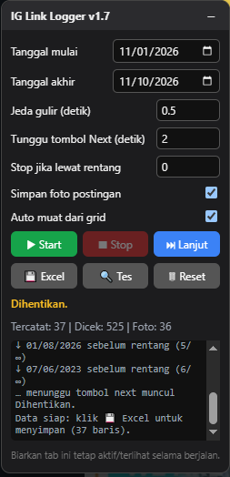

# IG Link Logger (Excel)




Userscript [Tampermonkey](https://www.tampermonkey.net/) yang **menggulir postingan Instagram secara otomatis**, membaca **tanggal postingan**, lalu **mencatat link** (dan menyimpan **foto**) postingan yang masuk dalam rentang tanggal pilihan Anda. Hasil link dapat disimpan ke file **Excel (.xlsx)** dengan kolom *No*, *Tanggal Postingan*, dan *Link*.

Cocok, misalnya, untuk merekap postingan lowongan kerja, pengumuman, atau konten lain dari satu akun/halaman dalam periode tertentu.

---

## Daftar Isi

- [Fitur](#fitur)
- [Cara Kerja Singkat](#cara-kerja-singkat)
- [Bahan / Persyaratan](#bahan--persyaratan)
- [Instalasi](#instalasi)
- [Penggunaan](#penggunaan)
- [Pengaturan di Panel](#pengaturan-di-panel)
- [Format Tanggal yang Dikenali](#format-tanggal-yang-dikenali)
- [Hasil Keluaran](#hasil-keluaran)
- [Kapan Program Berhenti Sendiri](#kapan-program-berhenti-sendiri)
- [Pengaturan Chrome yang Disarankan](#pengaturan-chrome-yang-disarankan)
- [Pemecahan Masalah](#pemecahan-masalah)
- [Keterbatasan](#keterbatasan)
- [Privasi & Keamanan](#privasi--keamanan)
- [Catatan Penggunaan](#catatan-penggunaan)
- [Riwayat Versi](#riwayat-versi)
- [Lisensi](#lisensi)

---

## Fitur

**Pencatatan**
- Klik otomatis tombol **Next** (panah kanan) untuk berpindah antar postingan.
- Membaca tanggal postingan dengan benar, termasuk format `January 21, 2023`, `April 25`, dan `6 days ago`.
- Filter **rentang tanggal** (tanggal mulai dan akhir, keduanya ikut dihitung).
- Menyalin link postingan (`https://www.instagram.com/p/<kode>/`) ke daftar hasil, tanpa duplikat.
- Tombol **Start**, **Stop**, dan **Lanjut**; Lanjut meneruskan tanpa menghapus data yang sudah ada.
- **Jeda gulir** dapat diatur sampai serendah 0,1 detik (ditambah sedikit variasi acak).

**Excel dan foto**
- Ekspor ke **.xlsx** asli (tanpa library eksternal): tanggal tersimpan sebagai tanggal Excel (`dd/mm/yyyy`) dan link bisa diklik.
- **Simpan foto postingan** otomatis, dengan nama file berupa tanggal postingan (`dd-mm-yyyy.jpg`).
- Excel **tidak terunduh otomatis**: Anda yang menentukan kapan menyimpan lewat tombol **Excel**.

**Ketahanan**
- Tidak salah mengklik tombol Next milik carousel foto.
- Sabar menunggu tombol Next muncul saat Instagram sedang memuat postingan baru.
- **Auto muat dari grid:** bila Next macet atau daftar berulang, program menutup popup, men-scroll grid profil, lalu membuka postingan baru dan melanjutkan.
- Mendeteksi urutan postingan yang berulang atau mundur, dan berhenti dengan pesan yang jelas.
- Data dan pengaturan tersimpan di penyimpanan Tampermonkey, jadi tidak hilang saat halaman di-reload.
- Panel dapat digeser dan di-minimize, dilengkapi kotak log dan tombol **Tes** untuk diagnosa cepat.

---

## Cara Kerja Singkat

```
Buka postingan (popup) ──► baca tanggal ──► masuk rentang? ──► catat link (+ simpan foto)
        ▲                                         │ tidak
        │                                         ▼
        └──────────── klik Next ◄──────── lewati / hitung "lewat rentang"

Next macet / daftar berulang ──► tutup popup ► scroll grid ► buka postingan baru ► lanjut
```

Tanggal dibaca dari atribut `datetime` pada elemen tanggal postingan (paling akurat). Bila atribut itu tidak ada, teks tanggal yang tampil dibaca dan diterjemahkan sendiri.

---

## Bahan / Persyaratan

| Kebutuhan | Keterangan |
|---|---|
| Browser | **Google Chrome** (browser yang dipakai selama pengembangan). Browser berbasis Chromium lain kemungkinan bisa, tetapi belum dicoba |
| Ekstensi | **Tampermonkey** v5.x (versi lain mungkin bekerja) |
| Akun | Akun Instagram yang sudah **login** di browser yang sama |
| Library | **Tidak ada**. Pembuatan file `.xlsx` ditulis langsung di dalam script |
| Koneksi | Akses ke `instagram.com` dan CDN gambar Instagram (`cdninstagram.com`, `fbcdn.net`) untuk fitur simpan foto |
| Izin Tampermonkey | `GM_getValue`, `GM_setValue`, `GM_xmlhttpRequest` (cadangan unduh foto) |

---

## Instalasi

### Cara 1: Manual (disarankan)

1. Pasang ekstensi **Tampermonkey** dari Chrome Web Store.
2. Pastikan Tampermonkey boleh menjalankan userscript: buka `chrome://extensions`, klik **Details** pada Tampermonkey, lalu aktifkan **Allow User Scripts** (pada versi Chrome tertentu bernama *Developer mode* di pojok kanan atas halaman ekstensi).
3. Klik ikon Tampermonkey, pilih **Create a new script**.
4. Hapus seluruh isi editor, lalu **tempel** seluruh isi file [`_link_logger.user.js`](Code/ig_link_logger.user.js).
5. Simpan dengan **Ctrl+S**.
6. Buka (atau **reload**) halaman Instagram. Panel **IG Link Logger** akan muncul di kiri bawah layar.

### Cara 2: Satu klik dari GitHub

Setelah file diunggah ke repositori Anda, buka versi *raw*-nya di browser. Tampermonkey akan menawarkan instalasi otomatis:

```
https://raw.githubusercontent.com/denta-ah/IGLinkLogger/main/Code/ig_link_logger.user.js
```


### Memperbarui versi

Ganti seluruh isi script di Tampermonkey dengan versi terbaru (Ctrl+A, tempel, Ctrl+S), lalu reload Instagram. Judul panel menampilkan nomor versi yang sedang aktif.

---

## Penggunaan

1. **Buka halaman profil** akun yang ingin direkap (atau halaman hashtag), lalu **klik sebuah postingan** hingga tampil sebagai popup. Mulailah dari postingan terbaru yang ingin dicek.
2. Atur panel:
   - **Tanggal mulai** dan **Tanggal akhir**.
   - **Jeda gulir** (misalnya 1 detik).
   - Aktifkan atau matikan **Simpan foto postingan** dan **Auto muat dari grid**.
3. Klik **🔍 Tes** (disarankan). Pastikan log menampilkan kode postingan, tanggal terbaca, dan `next: ketemu`.
4. Klik **▶ Start**. Program akan membaca tanggal, mencatat yang masuk rentang, lalu menggulir ke postingan berikutnya.
5. Pantau kolom **Tercatat | Dicek | Foto** dan kotak log.
6. Setelah selesai (atau kapan saja), klik **💾 Excel** untuk menyimpan hasil.

Selama program berjalan, **biarkan tab Instagram terlihat di layar**. Chrome memperlambat tab yang tertutup jendela lain.

### Tombol

| Tombol | Fungsi |
|---|---|
| **▶ Start** | Mulai dari postingan yang sedang terbuka. Data lama dihapus (dengan konfirmasi) |
| **■ Stop** | Menghentikan proses. Data tetap tersimpan |
| **⏭ Lanjut** | Meneruskan dari postingan yang sedang terbuka tanpa menghapus data |
| **💾 Excel** | Menyimpan hasil ke file `.xlsx` |
| **🔍 Tes** | Mengecek deteksi kode postingan, tanggal, tombol Next, dan foto, tanpa menggulir |
| **🗑 Reset** | Menghapus semua data yang tercatat |
| **–** / **+** (di judul panel) | Menyembunyikan atau menampilkan isi panel. Judul panel bisa digeser |

---

## Pengaturan di Panel

| Pengaturan | Bawaan | Keterangan |
|---|---|---|
| Tanggal mulai / akhir | 30 hari terakhir | Rentang tanggal yang dicatat (batas awal dan akhir ikut dihitung) |
| Jeda gulir (detik) | 4 | Minimal 0,1. Program menambah variasi acak sekitar 0 sampai 30% |
| Tunggu tombol Next (detik) | 2 | Lama menunggu tombol Next muncul atau URL berpindah sebelum dianggap macet. Minimal 0,5 |
| Stop jika lewat rentang | 3 | Berhenti setelah N postingan berturut-turut lebih lama dari tanggal mulai. **0 = nonaktif** |
| Simpan foto postingan | Aktif | Mengunduh foto postingan yang dicatat |
| Auto muat dari grid | Aktif | Memuat postingan baru lewat grid profil saat Next macet atau daftar berulang |

> **Tips:** nilai *Stop jika lewat rentang* sengaja 3, bukan 1, karena postingan yang di-pin bisa muncul di atas dengan tanggal lama. Untuk halaman yang urutannya **tidak kronologis** (misalnya hashtag atau explore), set ke **0**.

---

## Format Tanggal yang Dikenali

Tanggal normalnya dibaca dari atribut `datetime`, sehingga akurat sampai hari. Bila tidak tersedia, teks berikut dikenali (Inggris dan Indonesia):

| Tampilan di Instagram | Dibaca sebagai |
|---|---|
| `January 21, 2023` / `21 Januari 2023` | Tanggal penuh |
| `April 25` / `25 April` | Tanggal itu di tahun berjalan (atau tahun lalu bila hasilnya di masa depan) |
| `6 days ago` / `6 hari yang lalu` | Hari ini dikurangi 6 hari |
| `3 hours ago` / `3 jam yang lalu` | Hari ini (atau kemarin bila melewati tengah malam) |
| `yesterday` / `kemarin` | Kemarin |
| `2 weeks ago`, `1 month ago`, `1 year ago` | **Perkiraan** (dikurangi 7 hari, 1 bulan, 1 tahun) |

---

## Hasil Keluaran

### File Excel

Nama file: `instagram_links_YYYYMMDD_HHMM.xlsx`, sheet **Links**.

| No | Tanggal Postingan | Link |
|---|---|---|
| 1 | 04/11/2026 | https://www.instagram.com/p/xxxxxxxxxxx/ |
| 2 | 21/10/2026 | https://www.instagram.com/p/yyyyyyyyyyy/ |

- Kolom tanggal berisi tanggal Excel sungguhan, jadi bisa diurutkan dan difilter.
- Kolom link berupa hyperlink yang bisa diklik.
- Bila pembuatan `.xlsx` gagal karena suatu hal, program otomatis menyimpan **CSV** sebagai cadangan.

### Foto

- Disimpan ke folder **Downloads** dengan nama `dd-mm-yyyy.jpg` (garis miring tidak boleh dipakai pada nama file, jadi dipakai tanda `-`).
- Beberapa postingan pada tanggal yang sama diberi akhiran: `04-11-2026.jpg`, `04-11-2026_2.jpg`, `04-11-2026_3.jpg`, dan seterusnya.
- Yang diambil adalah foto utama dengan resolusi terbesar yang tersedia. Pada postingan carousel, hanya **foto pertama** yang disimpan.
- Postingan video atau reel tidak punya foto, jadi dilewati dan dicatat di log.

---

## Kapan Program Berhenti Sendiri

| Pesan status | Penyebab |
|---|---|
| `Selesai: sudah melewati rentang tanggal.` | Sudah N postingan berturut-turut lebih lama dari tanggal mulai |
| `Selesai: tidak ada postingan baru lagi di grid (akhir profil).` | Grid sudah di-scroll sampai habis dan tidak ada postingan baru |
| `Selesai: tombol next tidak muncul / tidak ada postingan berikutnya.` | Tombol Next tidak ada atau tidak berpindah, dan **Auto muat dari grid dimatikan** |
| `Berhenti: urutan postingan berulang ...` | Urutan kembali ke postingan lama berulang kali (Auto muat dari grid mati) |
| `Berhenti: tanggal gagal terbaca 5x berturut-turut.` | Tanggal 5 postingan beruntun tidak terbaca |
| `Berhenti: 90 detik tanpa postingan baru yang dicek.` | Tidak ada kemajuan selama 90 detik |
| `Berhenti: gagal menutup/membuka postingan dari grid...` | Auto muat dari grid tidak berhasil menutup popup atau membuka postingan |
| `Halaman bukan postingan lagi (modal tertutup?).` | Popup tertutup sendiri atau Anda berpindah halaman |

Saat berhenti, data **tidak hilang**. Klik **💾 Excel** untuk menyimpannya.

---

## Pengaturan Chrome yang Disarankan

Untuk fitur **simpan foto**, atur di `chrome://settings/downloads`:

- Matikan **Tanyakan lokasi penyimpanan sebelum mengunduh**. Bila tidak, dialog simpan muncul untuk setiap foto.
- Saat Chrome menampilkan *"Situs ini ingin mengunduh beberapa file"*, pilih **Izinkan**. Bila diblokir, unduhan berikutnya tidak berjalan.

Saat Tampermonkey meminta izin koneksi ke `cdninstagram.com` (hanya terjadi bila unduhan biasa diblokir browser), pilih **Always allow**.

---

## Pemecahan Masalah

**Panel tidak muncul**
- **Reload** tab Instagram setelah memasang atau mengubah script. Userscript hanya aktif saat halaman dimuat.
- Bila reload dilakukan saat berada di alamat `/p/...`, Instagram menampilkan halaman postingan penuh tanpa tombol panah. Reload dari halaman profil, lalu klik postingan.
- Pastikan **Allow User Scripts** aktif (lihat [Instalasi](#instalasi), langkah 2) dan script dalam keadaan *Enabled*.
- Buka Console (`F12`): bila berhasil, muncul `[IG Link Logger] v1.7 aktif`. Bila muncul banner merah *"IG Link Logger error"*, catat pesannya dan laporkan.

**Tombol 🔍 Tes menunjukkan `next: TIDAK ketemu`**
- Pastikan postingan dibuka sebagai popup dari grid profil (bukan halaman postingan penuh).
- Struktur halaman Instagram bisa berubah. Laporkan isi log agar selector dapat disesuaikan.

**Tanggal tidak terbaca**
- Jalankan **Tes** dan lihat baris `tanggal:`. Bila tertulis `TIDAK terbaca`, laporkan tampilan tanggal di postingan tersebut.

**Foto tidak terunduh**
- Periksa izin unduhan ganda dan dialog simpan di Chrome (lihat bagian pengaturan di atas).
- Lihat log: baris `✗ foto gagal ...` menampilkan alasannya (misalnya izin `@connect` ditolak atau timeout).

**Jumlah "Dicek" tidak bertambah**
- Lihat log. Baris `⟳ ke-N dari M sudah dicek` menunjukkan program sedang melewati postingan yang sudah pernah dicek (misalnya setelah Anda mundur manual lalu menekan Lanjut). Program akan terus maju sampai menemukan postingan baru.

**Proses terasa macet pada status "Jeda..."**
- Biarkan jendela Instagram terlihat penuh. Chrome memperlambat timer pada tab yang tertutup jendela lain atau di latar belakang.

**Instagram menampilkan pembatasan (misalnya "coba lagi nanti")**
- Naikkan **Jeda gulir**, hentikan beberapa saat, lalu lanjutkan.

---

## Keterbatasan

- Bergantung pada struktur halaman Instagram saat ini. Bila Instagram mengubah tampilannya, sebagian fungsi mungkin perlu disesuaikan.
- Pada postingan carousel hanya foto pertama yang disimpan. Video dan reel tidak diunduh.
- Perkiraan tanggal dari teks relatif (`weeks/months ago`) hanya dipakai bila atribut `datetime` tidak tersedia.
- Fitur *Stop jika lewat rentang* mengandalkan urutan postingan yang kronologis (terbaru ke terlama).
- Tab harus tetap aktif dan terlihat selama program berjalan.
- Daftar postingan yang sudah dicek (`Dicek`) hanya disimpan selama halaman terbuka. Hasil tercatat (link dan tanggal) tetap tersimpan setelah reload.

---

## Privasi & Keamanan

- Script berjalan **sepenuhnya di browser Anda**. Tidak ada data yang dikirim ke server pihak ketiga.
- Satu-satunya koneksi tambahan adalah pengunduhan gambar dari CDN Instagram (untuk fitur simpan foto).
- Data (daftar link, tanggal, dan pengaturan) disimpan lokal di penyimpanan Tampermonkey.
- Script tidak membaca atau menyimpan kata sandi maupun cookie akun Anda.

---

## Catatan Penggunaan

- Gunakan dengan wajar dan untuk keperluan pribadi. Pengaksesan otomatis dapat bertentangan dengan **Ketentuan Layanan Instagram**, dan Instagram dapat membatasi akun yang dianggap terlalu agresif. Gunakan jeda yang aman (disarankan minimal 1 sampai 3 detik) dan risikonya ditanggung pengguna.
- Hormati hak cipta dan privasi pemilik konten. Foto dan link yang dikumpulkan tetap milik pemilik akunnya.
- Proyek ini tidak berafiliasi dengan, didukung, atau disponsori oleh Instagram atau Meta.

---

## Riwayat Versi

| Versi | Perubahan |
|---|---|
| **1.7** | Excel tidak lagi tersimpan otomatis (hanya lewat tombol). Waktu tunggu tombol Next dipersingkat dan bisa diatur |
| **1.6** | Auto muat dari grid: menutup popup, scroll grid, dan membuka postingan baru saat Next macet atau daftar berulang |
| **1.5** | Pelacakan urutan postingan: membedakan "mengejar posisi lama" dari daftar yang berulang atau mundur |
| **1.4** | Tidak lagi mengklik tombol carousel, sabar menunggu tombol Next, melewati cepat postingan yang sudah dicek, dan ada pengaman 90 detik |
| **1.3** | Fitur simpan foto postingan dengan nama file tanggal postingan |
| **1.2** | Jeda gulir bisa di bawah 1 detik (minimal 0,1 detik) |
| **1.1** | Tanpa library eksternal (pembuat `.xlsx` bawaan), panel tanpa `innerHTML`, tombol Tes, banner error |
| **1.0** | Versi awal: gulir otomatis, filter tanggal, ekspor Excel |


---

## Lisensi

Hak cipta © 2026 Denta Arvihaknata.
